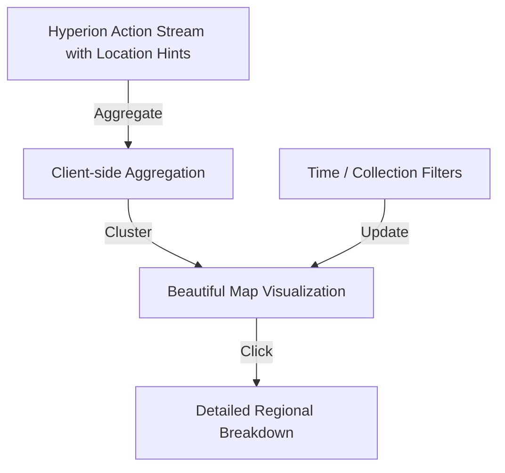

# wax-geolocated-drop-claim-map — Geolocated Drop & Claim Distribution Map

> **Status:** 🔒 Private (In Development) | Target Public Release: August 2026  
> **Category:** Phygital (RWA) Redemptions & Supply-Chain Legibility  
> **Parent Catalog:** [pixel-journey/wax-ecosystem-blueprint-catalog](https://github.com/pixel-journey/wax-ecosystem-blueprint-catalog)

**One-sentence goal:** An interactive regional map visualizer that parses on-chain transaction location proofs and coordinate data (from memos, mutable metadata, or optional oracles) to beautifully plot the geographic distribution of real-world phygital drops, claims, and redemptions, revealing global collector engagement patterns on WAX.

---

## 1. Overview & Goal

This blueprint brings geographic context to WAX phygital activity. It shows where in the world collectors are claiming and redeeming physical items, helping brands understand their global reach and optimize future drops.

- **Why it matters:** Phygital projects are global. Seeing real geographic distribution of claims builds excitement, informs marketing, and proves authentic worldwide engagement.
- **Public infrastructure only:** Hyperion for action data (with location hints in memos or metadata), AtomicAssets for asset provenance, client-side map rendering (Leaflet/Mapbox GL or similar open libs). Optional simple oracle for verified coordinates. No custom contracts.
- **Target users:** Phygital brands running global drops, event organizers, analysts studying Web3 adoption geography, collectors seeing community hotspots.
- **Success metrics:** "Beautiful interactive map of global claims in <3s", "Enable brands to see true geographic reach of their drops", "Create shareable regional engagement visuals".

---

## 2. Concepts & Inspiration

- **Core concepts:** On-chain actions can carry location signals (IP hints, user-submitted coordinates in memos, or brand-pushed mutable data). Aggregating these creates heatmaps of real-world engagement. Privacy-first: aggregate or anonymized views by default.
- **Pain points:** Brands have no beautiful way to visualize where their community is physically located. Collectors love seeing "my city lit up on the map".
- **Inspirations:** Google Maps + Strava heatmaps, election result maps, traditional event check-in visualizations. Web3: on-chain provenance + beautiful interactive geography.
- **Cross-references:** Pairs with `wax-phygital-redemption-milestone-stepper` and custody timeline for full journey view. Great companion to social and generative blueprints.

---

## 3. Design Specifications (Pixel Journey Standards)

### 3.1 Visual & Interaction Design
- Beautiful interactive world/regional map with clustered markers or heatmaps for claim density.
- Sidebar or top bar: Time range, collection filter, metric toggle (claims, burns, redemptions).
- Color: Vibrant yet professional — deep blues for oceans, warm accents for high-activity zones.
- Micro-interactions: Click cluster → regional breakdown panel with top cities and recent claims.
- Responsive: Full map on desktop; simplified regional view or list fallback on mobile.

### 3.2 Key Views / Components
- `GeolocatedMap.tsx` — Main interactive map (Leaflet or Mapbox GL JS).
- `ClaimCluster.tsx` — Custom markers/clusters with count and recent activity.
- `RegionBreakdownPanel.tsx` — Sidebar with city-level stats and top collectors (anonymized).
- `TimeRangeFilter.tsx` — Clean controls for historical views.

### 3.3 Accessibility (A11y) & Inclusive Design
- WCAG 2.2 AA: Map alternatives (data table view), keyboard navigation for filters, screen reader summaries of regional stats.
- High contrast markers and labels.
- Option to disable map animations.

### 3.4 Performance & Optimization Targets
- Efficient clustering for thousands of points (use libraries like react-leaflet or supercluster).
- Data aggregation on client or lightweight backend if needed; prefer pure client-side where possible.
- Fast initial load with cached regional summaries.

---

## 4. Technical Architecture

### 4.1 Core Tech Stack
- Next.js 15 + TypeScript + Tailwind + shadcn/ui
- Leaflet / react-leaflet or Mapbox GL for maps (open-source friendly)
- @tanstack/react-query for data
- Hyperion for geolocated actions (memos or metadata with coords)
- date-fns for time filtering

### 4.2 Data Flow Diagram


### 4.3 Folder Structure
```
app/
├── (dashboard)/page.tsx
├── components/
│   ├── map/
│   │   ├── GeolocatedMap.tsx
│   │   └── ClaimCluster.tsx
│   └── panel/
│       └── RegionBreakdownPanel.tsx
├── hooks/useGeolocatedClaims.ts
├── lib/wax/
│   ├── hyperion-geo.ts
│   └── geo-aggregator.ts
└── types/geo.ts
```

### 4.4 Security & Privacy
- Aggregate views by default (no individual user locations exposed).
- Optional privacy mode: city-level only or heatmaps without exact pins.
- Clear disclaimers on data sources and privacy.

---

## 5. Implementation Examples & Code Snippets

**Core data hook**
```ts
// hooks/useGeolocatedClaims.ts
export function useGeolocatedClaims(collection?: string, timeRange?: string) {
  return useQuery({
    queryKey: ['geo-claims', collection, timeRange],
    queryFn: async () => {
      const actions = await fetchHyperionActionsWithGeo(collection, timeRange);
      return aggregateByRegion(actions);
    }
  });
}
```

**Map rendering (conceptual)**
```tsx
<GeolocatedMap 
  data={regionalData} 
  onRegionClick={showBreakdown} 
/>
```

---

## 6. Demo & Testing
- Mock data with global claim distribution for a sample phygital drop.
- Live mode with real Hyperion data (anonymized/aggregated).
- Interaction tests: zoom, cluster click, filter changes.
- Playwright for end-to-end map flows.

---

## 7. Roadmap
Standard phases: data aggregation layer → map integration → UI polish & filters → a11y & performance → full documentation.

Future: Heatmap intensity controls, exportable regional reports for brands, integration with event calendar blueprints.

---

## 8. Visual References
> Stunning interactive maps like Strava global heatmaps or election result visualizations meets clean Web3 dashboard. Clustered pins with subtle animations. Beautiful typography for city names and counts. Reference: Strava activity maps + modern data viz tools (e.g. Observable or Flourish).

---

## 9. Related Blueprints
- Phygital redemption and custody timelines — Geographic context for the full journey.
- Social and P2P messaging blueprints — Community hotspots.
- Any drop or event related ideas.

---

## 10. License & Credits
MIT. Built to showcase the global reach of WAX phygital projects using public data.

**Pixel Journey — Beautiful interfaces for public blockchain data.**
